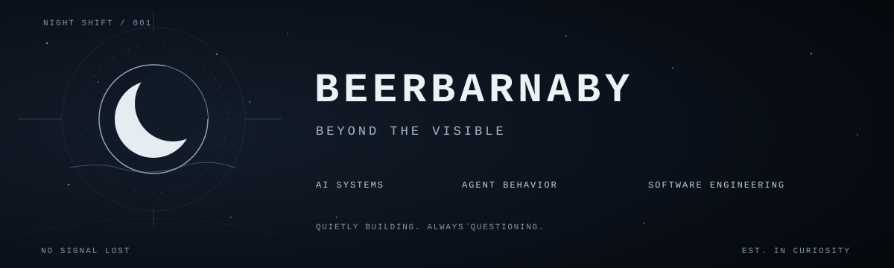

<div align="center">
  

  <br />

  <samp>Not every idea needs a spotlight.</samp>
</div>

<br />

```text
> connection established
> identity   : BeerBarnaby
> interests  : intelligence / behavior / interfaces
> approach   : observe -> question -> build -> evaluate
> status     : quietly in progress
```

### `01 / BELOW THE SURFACE`

I build **AI-powered software** and explore how intelligent systems behave.

My work moves between **LLM applications**, **multi-agent experiments**, **model evaluation**, and **full-stack engineering**.

Less noise. Better questions. Systems that actually work.

### `02 / INSTRUMENTS`

`Python` · `TypeScript` · `JavaScript` · `Next.js` · `SQL` · `Docker` · `Git`

`LLMs` · `Multi-Agent Systems` · `AI Evaluation` · `APIs`

---

<div align="center">
  <sub>THE INTERESTING PART IS USUALLY WHAT YOU CAN'T SEE.</sub>
</div>
