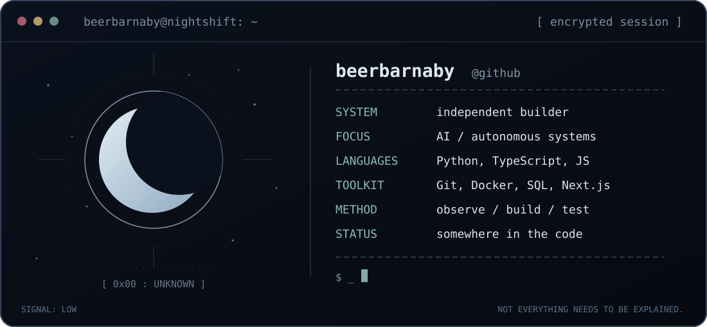

<div align="center">
  

  <br />
  <samp>Not every idea needs a spotlight.</samp>
</div>

<br />

```console
$ whoami
beerbarnaby

$ cat /etc/motd
Some signals are meant to stay hidden.
```

<details>
<summary><code>↳ reveal installed tools</code></summary>

<br />

`Python` · `TypeScript` · `JavaScript` · `Next.js` · `SQL` · `Docker` · `Git`

`LLMs` · `Multi-Agent Systems` · `AI Evaluation` · `APIs`

</details>

<div align="center">
  <br />
  <sub>THE INTERESTING PART IS USUALLY WHAT YOU CAN'T SEE.</sub>
</div>
